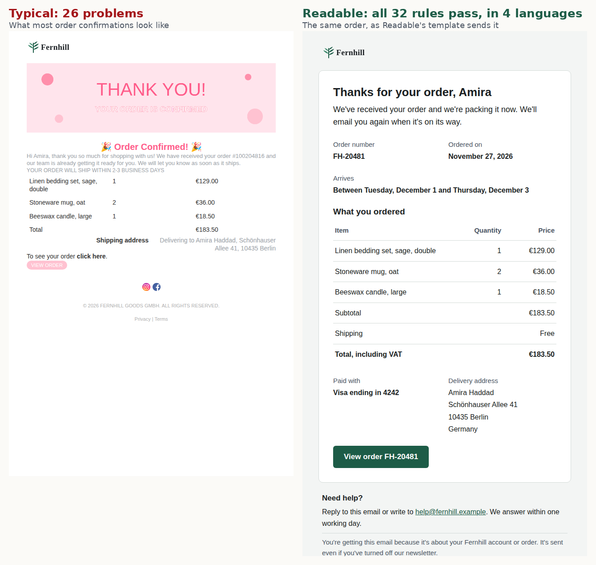
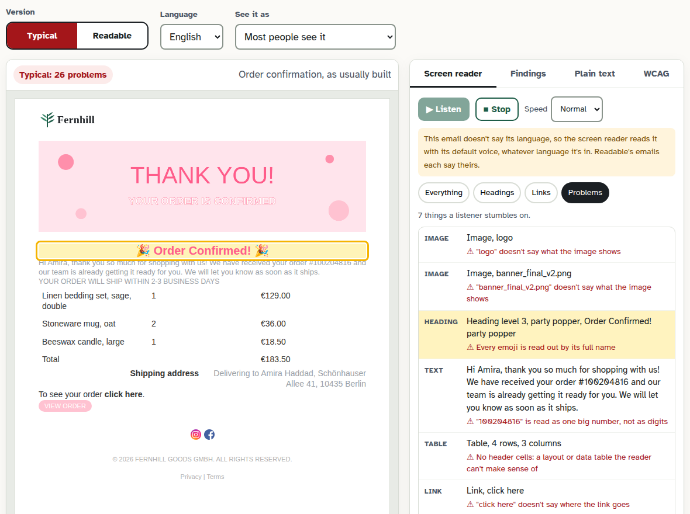

# Readable

**Transactional emails everyone can read: four accessible templates, built with Hyper Elements, that can't be sent if they break.**

**Live: [readable-email.vercel.app](https://readable-email.vercel.app).** Pick an email and press **Listen** to hear it the way a screen reader reads it, with each element highlighted as it's read. Switch between the typical version and Readable's, see it as someone with a colour vision deficiency, low vision or a 320 px phone would, or **paste your own email's HTML** and check it.

Since 28 June 2025, the European Accessibility Act requires online shops in the EU to make their services accessible, and the emails customers get are part of them. Most order confirmations, shipping updates and password resets still fail: grey small print, "click here", a sign-in code read aloud as "four hundred eighty-two thousand…", a banner image saying "THANK YOU!" with the alt text `banner_final_v2.png`. Nobody notices, because nobody on the team hears them the way a screen reader user does.

Readable is three things:

1. **`readable()`, a WCAG plugin for Hyper Elements.** It runs `@hyper-elements/lint` and adds **13 rules lint doesn't have**, such as tap target size, button edge contrast, links that rely on colour alone, codes read as one number, emoji in headings, the `dir="rtl"` column swap, and layout tables without `role="presentation"`. It describes them the way lint describes its own, so **a template requires them like lint's, and `check()` fails closed**.
2. **Four templates**: order confirmation, shipping update, password reset and new sign-in alert. Each comes in four languages (English, German, French, and Arabic, which reads right to left). Each template requires **all 32 rules** that can run on a transactional email, and passes every one in every language.
3. **A conformance report for each**, a Hyper Elements `Document` printed to PDF. It maps the template's `check()` results to the WCAG 2.2 success criteria, so whoever has to show the shop's emails meet the Act has something to show.



*The same order, twice. On the left, the way order confirmations are usually built: 26 problems. On the right, Readable's template: every one of its 32 required rules passes, in all four languages.*

## Hear the difference



The site reads the email aloud with your browser's own voices and highlights each element as it's read. Its transcript (*Everything*, *Headings*, *Links*, *Problems*) is what a screen reader user hears. The "typical" email above has no `lang`, so it's read in the default voice whatever its language. The banner is read as "banner_final_v2.png" and the heading as "party popper, Order Confirmed! party popper". The order number is read as one number, and the links list says "click here". Readable's version reads as you'd hope: one heading per section, every price with its column ("Price, €129.00"), and the code as "482 913".

The screen reader is a model of how NVDA and VoiceOver move through email HTML (headings, links, image alts, data tables, lists, language). It isn't a recording of either.

## The rules Hyper Elements didn't have

| Rule | WCAG 2.2 | What it finds |
| --- | --- | --- |
| `target-size` | 2.5.8 (AA) | A button or social icon smaller than 24×24 px |
| `non-text-contrast` | 1.4.11 (AA) | A button whose background is under 3:1 against what's behind it, with no border that is |
| `link-distinct` | 1.4.1 (A) | A link in a sentence, not underlined, under 3:1 against the text around it |
| `headings` | 1.3.1, 2.4.6 | No heading to navigate by, or the first one isn't level 1 |
| `table-header` | 1.3.1 (A) | A data table with no header row, so no cell is read with its column |
| `reading-order` | 1.3.2 (A) | A Row with `dir` reversed to swap its columns: read in the other order to how they're shown |
| `layout-table` | 1.3.1 (A) | A table in an `Html` block with no header cells and no `role="presentation"` |
| `code-readout` | best practice | Six or more digits in a row, read as one number: the template groups them ("482 913") |
| `emoji` | best practice | An emoji in a heading, button or link, read by its full name as part of it |
| `all-caps` | best practice | A long run of capitals, slower to read, and some screen readers spell it out |
| `justified` | 1.4.8 (AAA) | Justified text and its uneven gaps |
| `line-height` | 1.4.8, 1.4.12 | A paragraph with line height under 1.4 |
| `centered-text` | best practice | A long centred paragraph, hard to follow with a magnifier |

Each has a `fix`, a `see` link to [docs/rules.md](docs/rules.md) and the WCAG criterion it's about. Each is tested both ways in [`src/test.tsx`](src/test.tsx): it finds its problem, and it's quiet once the problem is fixed.

## How Hyper Elements is used

| Need | Hyper Elements |
| --- | --- |
| New accessibility rules | The plugin API: `check(input)` reads the laid-out tree (resolved text colour, size, line height and alignment, padding, borders, each node's path), and `templatePath()` and `builtIn()` see inside built-ins such as `Social` |
| Rules a template requires | `rules.plugins.lint: readable()` and `rules.require.lint: [...]`: Readable's rules are described the way lint's are (`rules` descriptors), so `check()` decides them the same way, and a plugin that throws decides nothing (`not-run`) instead of passing |
| Every check lint already has | `@hyper-elements/lint`: contrast, alt text, link text, empty links, link targets, heading order, empty headings, text size, `lang`, `dir`, preview text, merge syntax, `role="button"` |
| Typed, locked templates | `template()` with `prop.*` fields: an order number pattern, a six-digit code, a carrier `choice` the tracking link is built from, a language `choice` |
| Links that can't go astray | `rules.links`: only the shop's domain, the three carriers, and `mailto:` |
| Root props that must be there | `rules.root: { lang, title, previewText }` |
| Layout that doesn't break | Core `layout/overflow` on emails, `document/overflow` on the report (it caught the report spilling off page 1 before I did) |
| Right to left | `dir` and `lang` on `Email`; columns follow the direction |
| Semantics | What Hyper Elements writes: `role="presentation"` on layout tables, `<th scope="col">` for a `TableRow header`, `<ol>` and `<ul>` lists, `<h1>`–`<h6>`, an `<a>` for every button |
| The plain-text part | `render()`'s `text`, checked against the HTML: every link, heading and table cell must be in it |
| The conformance report | A second `template()` with a `Document` root, with `PageBreak`, `PageFooter` and `PageNumber`, printed to PDF |
| Email clients, and dark mode | `@hyper-elements/email-clients`: Outlook, Gmail and Apple Mail, light and dark, with 0 findings for all four templates (linked from the site) |
| Your own email | `lintHtml()` from `@hyper-elements/lint/html`, bundled for the browser, plus Readable's rules run on the page as laid out |

## Run it

Node.js 20 or later. `npm run build` prints the reports and draws the PNGs with Chrome or Chromium. It's found automatically, or set `CHROME_PATH`.

```bash
npm install
npm test          # every rule both ways, every template in every language, the typical versions refused
npm run build     # out/<template>/: each email in 4 languages (.html, .txt), report.pdf, before.html, client previews
npm run site      # the site → site/dist (deployed to Vercel from vercel.json)
npm run typecheck
```

### Use the plugin in your own templates

```tsx
import { template } from "@hyper-elements/react/template";
import { readable } from "./src/wcag";

export const Receipt = template({
  id: "acme.Receipt",
  root: "Email",
  rules: {
    plugins: { lint: readable({ kind: "transactional" }) },
    require: { lint: ["contrast", "link-text", "lang", "target-size", "non-text-contrast", "code-readout", "emoji"] },
  },
  // fields, example, render …
});

Receipt.check(values).valid; // false, with diagnostics, if any required rule finds something
```

Or without a template: `validate(<MyEmail />, { plugins: [readable()] })` lists everything lint and Readable find, as warnings.

## Files

```text
src/wcag/            the plugin: rules.ts (13 rules, each with its WCAG criterion), index.ts (readable()), color.ts
src/templates/       order-confirmation, shipping-update, password-reset, sign-in-alert, shared.tsx (frame, rules), report.tsx
src/copy.ts          every fixed word in English, German, French and Arabic
src/before.tsx       the typical version of each email
src/criteria.ts      WCAG 2.2 criteria for email, and how each is covered
src/audit.ts         check() in every language, plain-text parity, criteria decided (runs in Node and the browser)
src/test.tsx         the proof, run in CI (.github/workflows/ci.yml)
src/build.tsx        emails, reports, client previews, docs/rules.md
site/                the live site: sr.ts (the screen reader), dom-audit.ts (checks for pasted HTML), app.ts
out/                 the built emails, plain text and reports, committed so you can open them here
```

## Notes

- Automated checks find many barriers, not all. Each report lists the criteria a person still confirms: that alt text describes the image, that instructions don't depend on colour or position, and that time limits say when and what then. Readable's templates are written to meet those, and the report says how.
- EN 301 549, the standard the Act points to, requires WCAG 2.1 level AA. The reports check WCAG 2.2 AA, which includes it.
- Fernhill is a made-up shop. Its images are served from the live site.
- Built with `@hyper-elements/react` 0.5.2, `@hyper-elements/lint` 0.1.11 and `@hyper-elements/email-clients` 0.5.3.

MIT licensed.
